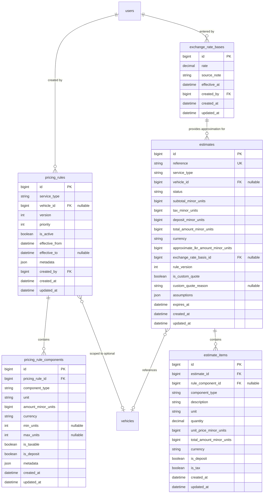

# Phase 06 Concepts Brief: Pricing, Policy, and Immutable Estimates

* **Author:** Lead System Architect
* **Date:** 2026-11-24
* **Target Phase:** Phase 06 (`phase/06-pricing-policy-estimates`)
* **Role:** Lead System Architect (Full Elephant-Goldfish Model Workflow)

---

## 1. Context & Business Domain

Spinellanka operates an advance-booking luxury transport platform in Sri Lanka across a fleet of five exact vehicles providing four distinct services:
1. **Airport Pickup** (chauffeured, meet-and-greet, waiting time, parking/tolls);
2. **Airport Transfer** (chauffeured, route contingency, flight departure timing);
3. **Ride** (chauffeured point-to-point or multi-stop, per-stop waiting, optional return legs);
4. **Rent** (self-drive, 24-hour hire cycles, excess mileage, refundable security deposits).

Unlike ride-hailing aggregators with dynamic surge algorithms, Spinellanka requires:
- **Transparent, predictable estimates** presented primarily in USD with an approximate LKR equivalent;
- **Relational, effective-dated pricing rules** scoped by service and exact vehicle;
- **Strict Money precision**: Integer minor units (cents) to eliminate any floating-point arithmetic errors;
- **Immutable snapshot estimates**: Pre-submission calculations preserve the exact rule version, itemized components, exchange basis, and traveler assumptions;
- **Separate refundable deposits**: Rent security deposits are tracked separately and never blended into revenue or service fee totals;
- **Audited manual USD/LKR approximation**: Third-party live forex APIs are explicitly rejected to maintain deterministic stability and staff control;
- **Transparent Custom-Quote fallback**: Whenever rules are missing, expired, ambiguous, or the requested route/duration falls outside defined parameters, the system gracefully degrades to a clear custom-quote request rather than fabricating plausible numbers.

---

## 2. Core Architectural Questions & Trade-Offs

### 2.1 Money Value Object: Integer Minor Units vs Floating Point
- **Option A (Floating Point `float` / `double`)**: Standard PHP `float` arithmetic.
  - *Verdict*: **Strictly Rejected**. `0.1 + 0.2 !== 0.3` binary rounding errors cause reconciliation discrepancies, currency drift, and financial calculation corruption.
- **Option B (Arbitrary Precision `bcmath` strings)**: String representation using `bcadd`/`bcmul`.
  - *Verdict*: Good for sub-cent financial accounting, but unnecessary overhead for standard fiat currency with discrete minor units (cents / cents equivalents).
- **Option C (Integer Minor Units with ISO-4217 Currency)**: An immutable `Money` value object storing an integer amount in minor units (`$amountMinorUnits: int`) and a 3-character ISO currency code (`$currency: Currency`).
  - *Verdict*: **Required by `docs/planning/03-domain-and-data-model.md`**. Represents $100.50 as `10050` USD. Arithmetic operations (`add`, `subtract`, `multiply`, `allocate`) operate purely on integers with explicit rounding algorithms (Round Half Up).

### 2.2 Pricing Rule Schema: Relational Rule Components vs Formula DSL
- **Option A (Opaque Formula / Scripting DSL)**: Storing executable formulas (e.g. `base + (distance * 1.5) + (stops * 10)`) as string expressions.
  - *Verdict*: **Rejected**. Difficult to validate, prone to runtime injection or syntax failures, non-indexable, impossible to audit visually in Filament, and fragile across upgrades.
- **Option B (Relational Rule Components)**: Two-tier normalized relational schema:
  - `pricing_rules`: Header defining service type, optional vehicle scope, version, effective date window `[effective_from, effective_to)`, priority, active status, and audit metadata.
  - `pricing_rule_components`: Itemized calculation lines defining component type (`base`, `distance`, `duration`, `stop`, `waiting`, `delivery`, `insurance`, `deposit`, `tax`, `discount`), pricing unit (`flat`, `per_km`, `per_hour`, `per_day`, `per_stop`, `percentage`), integer unit rate in minor units, and classification (`is_deposit`, `is_tax`).
  - *Verdict*: **Selected**. Highly auditable, supports granular itemization for customer-facing estimate breakdowns, fully indexable, and configurable via Filament staff UI.

### 2.3 Scope Precedence & Effective Dating
- When calculating an estimate for a given `service_type`, `vehicle_id`, and `service_date`:
  - Rules have date validity: `effective_from <= service_date` and (`effective_to IS NULL` or `effective_to > service_date`).
  - **Scope Precedence Hierarchy**:
    1. **Vehicle-Specific Rule** (`service_type` + specific `vehicle_id` matching);
    2. **Service-Wide Default Rule** (`service_type` + `vehicle_id IS NULL`).
  - If multiple active rules match the same scope, the rule with the highest `priority` (or highest `version`) resolves deterministically.
  - If no active rule matches, the system returns a `CustomQuoteResult`.

### 2.4 Immutable Estimate Snapshots
- Customer pre-submission estimates must be frozen as immutable records:
  - `estimates`: Unique public reference (`EST-XXXX`), service type, vehicle reference, total USD minor units, approximate LKR minor units, exchange basis reference, rule version snapshot, assumptions payload, status (`calculated`, `custom_quote_required`, `expired`, `superseded`), and expiration timestamp.
  - `estimate_items`: Detailed line items detailing component type, label, unit, quantity, unit rate minor units, line total minor units, currency, `is_deposit`, and `is_tax`.
- Once generated, an estimate is never mutated. When staff or travelers adjust parameters, a new estimate is generated.

### 2.5 Audited Manual USD/LKR Approximation Basis
- Travelers see prices primarily in USD, with an approximate LKR conversion.
- `exchange_rate_bases` records:
  - `rate`: Integer or high-precision decimal representation (e.g., LKR per 1 USD);
  - `source_note`: Audited attribution (e.g., "Central Bank of Sri Lanka indicative rate 2026-11-24");
  - `effective_at`: When the rate became authoritative for approximation;
  - `created_by`: Staff user ID.
- Approximations are explicitly labeled: "Approximate LKR based on indicative rate of [rate] LKR/USD set on [date]. Final payment is settled in USD."

### 2.6 Refundable Deposit Separation
- Self-drive Rent requires a security deposit.
- The deposit is:
  1. Calculated as a dedicated `deposit` component;
  2. Flagged as `is_deposit = true`;
  3. Stored in `estimate_items` with its own line total;
  4. Excluded from the taxable/service subtotal in `estimates`;
  5. Clearly articulated in the customer breakdown: `Service Total: $X` + `Refundable Deposit: $Y` = `Due at Checkout: $X + $Y`.

### 2.7 Transparent Custom-Quote Fallback
- An estimate calculation may fail to produce a deterministic price because:
  - No active pricing rule exists for the service/vehicle;
  - Route distance or destination is missing or unpriced;
  - Rental duration exceeds maximum allowed horizon;
  - Staff has flagged the vehicle as custom-quote only.
- Rather than throwing an unhandled exception or inventing a price, `PricingService` returns an `EstimateResult` with status `custom_quote_required`, attaching the transparent operational reason.

---

## 3. High-Level Entity Relationships

---

## 4. Invariants & Guardrails

1. **Integer Money Only**: All amounts in database, DTOs, and calculations are stored as integer minor units (`amount_minor_units`). Floating point arithmetic is prohibited.
2. **Fixed ISO Currency**: Default currency is `USD`. Approximate equivalent is `LKR`. Multi-currency math is prohibited without explicit exchange basis conversion.
3. **Refundable Deposit Isolation**: `deposit_minor_units` is never added to `subtotal_minor_units`.
4. **Deterministic Precedence**: Rule resolution is 100% deterministic (Vehicle Match > Service-Wide Match > Priority Order).
5. **Audit Trail**: Every change to pricing rules or exchange rate basis records an `audit_events` row.
6. **No Fabricated Production Prices**: The production database starts with zero pricing rules. Calculations without rules gracefully yield custom quotes.

