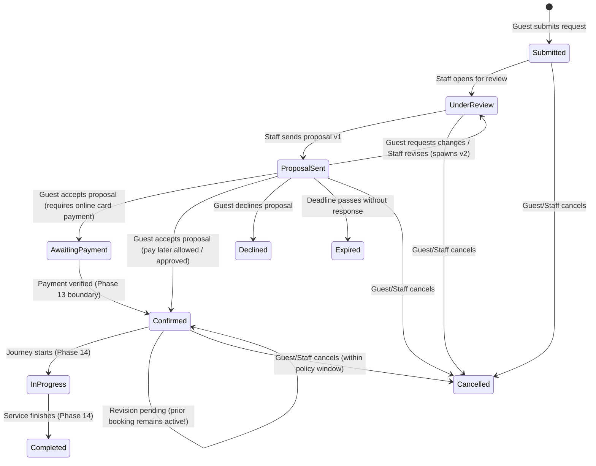

# EGM Phase 12 Design Draft: Versioned Proposals & Private Guest Control

## 1. Relational Schema & Models

### 1.1 `proposals` Table
```sql
CREATE TABLE proposals (
    id BIGINT UNSIGNED AUTO_INCREMENT PRIMARY KEY,
    booking_id BIGINT UNSIGNED NOT NULL,
    version INT UNSIGNED NOT NULL,
    reference VARCHAR(64) NOT NULL UNIQUE,
    status VARCHAR(32) NOT NULL DEFAULT 'draft', -- draft, sent, accepted, declined, superseded, expired
    vehicle_id BIGINT UNSIGNED NOT NULL,
    service_type VARCHAR(32) NOT NULL,
    schedule_block_id BIGINT UNSIGNED NULL,
    currency VARCHAR(3) NOT NULL DEFAULT 'USD',
    total_amount_minor_units INT UNSIGNED NOT NULL,
    approximate_lkr_amount_minor_units INT UNSIGNED NOT NULL,
    deposit_required BOOLEAN NOT NULL DEFAULT FALSE,
    deposit_amount_minor_units INT UNSIGNED NULL,
    payment_choice VARCHAR(32) NOT NULL DEFAULT 'full_or_pay_later', -- full_only, deposit_only, full_or_deposit, pay_later_only, full_or_pay_later
    selected_payment_choice VARCHAR(32) NULL, -- full, deposit, pay_later
    expires_at TIMESTAMP NULL,
    staff_notes TEXT NULL,
    internal_notes TEXT NULL,
    sent_by_user_id BIGINT UNSIGNED NULL,
    sent_at TIMESTAMP NULL,
    responded_at TIMESTAMP NULL,
    response_action VARCHAR(32) NULL, -- accepted, declined, change_requested, cancelled
    response_notes TEXT NULL,
    snapshot_data JSON NOT NULL,
    created_at TIMESTAMP NULL,
    updated_at TIMESTAMP NULL,
    FOREIGN KEY (booking_id) REFERENCES bookings(id) ON DELETE CASCADE,
    FOREIGN KEY (vehicle_id) REFERENCES vehicles(id),
    FOREIGN KEY (schedule_block_id) REFERENCES vehicle_schedule_blocks(id) ON DELETE SET NULL,
    FOREIGN KEY (sent_by_user_id) REFERENCES users(id) ON DELETE SET NULL,
    UNIQUE KEY uq_booking_proposal_version (booking_id, version),
    INDEX idx_proposals_booking_status (booking_id, status),
    INDEX idx_proposals_status_expires (status, expires_at),
    INDEX idx_proposals_reference (reference)
) ENGINE=InnoDB DEFAULT CHARSET=utf8mb4 COLLATE=utf8mb4_unicode_ci;
```

### 1.2 `proposal_items` Table
```sql
CREATE TABLE proposal_items (
    id BIGINT UNSIGNED AUTO_INCREMENT PRIMARY KEY,
    proposal_id BIGINT UNSIGNED NOT NULL,
    component_type VARCHAR(32) NOT NULL, -- base, distance, waiting, return, extra, fee, discount
    description VARCHAR(255) NOT NULL,
    quantity INT UNSIGNED NOT NULL DEFAULT 1,
    unit_amount_minor_units INT UNSIGNED NOT NULL,
    total_amount_minor_units INT UNSIGNED NOT NULL,
    created_at TIMESTAMP NULL,
    updated_at TIMESTAMP NULL,
    FOREIGN KEY (proposal_id) REFERENCES proposals(id) ON DELETE CASCADE,
    INDEX idx_proposal_items_proposal (proposal_id)
) ENGINE=InnoDB DEFAULT CHARSET=utf8mb4 COLLATE=utf8mb4_unicode_ci;
```

### 1.3 `bookings` Additions
Add foreign key pointer and revision tracking to `bookings`:
- `current_proposal_id`: BIGINT UNSIGNED NULL REFERENCES proposals(id) ON DELETE SET NULL
- `pending_revision`: BOOLEAN NOT NULL DEFAULT FALSE

### 1.4 `rent_details` Extension Fields
Ensure `rent_details` supports extension tracking:
- `extension_state`: JSON NULL (records pending extension requests, days/hours, requested return time)

---

## 2. Booking Lifecycle State Transitions



---

## 3. Services & Domain Logic

1. `ProposalService`:
   - `createProposal(Booking $booking, User $staff, CreateProposalData $data): Proposal`
   - `sendProposal(Proposal $proposal, User $staff): Proposal` (creates proposal hold, updates booking, dispatches outbox event)
   - `reviseProposal(Booking $booking, User $staff, ReviseProposalData $data): Proposal` (marks current proposal `superseded`, creates new incremented version)
   - `expireProposal(Proposal $proposal): void` (releases proposal hold, updates status)

2. `GuestControlService`:
   - `acceptProposal(Booking $booking, Proposal $proposal, ?string $paymentChoice, ?string $guestNotes): BookingTransitionResult`
   - `declineProposal(Booking $booking, Proposal $proposal, string $reason): void`
   - `requestChange(Booking $booking, string $requestedChanges): void`
   - `requestCancellation(Booking $booking, string $reason): void`
   - `requestRentExtension(Booking $booking, int $extraDays, int $extraHours, ?string $notes): void`
   - `rotateToken(Booking $booking): string` (plain token returned once)

3. `TokenSecurity`:
   - Uses `GuestAccessToken::generateToken()` (256-bit entropy).
   - Stores `GuestAccessToken::hashToken($plainToken)`.
   - Validates `isValid()` checking `revoked_at` and `expires_at`.
   - Neutral failure for invalid/expired tokens.

4. `Availability Integration`:
   - Proposal hold kind: `ScheduleBlockKind::ProposalHold`.
   - Linked to `schedule_block_id` on Proposal.
   - Clean deletion/release on expiry, rejection, or supersession.

