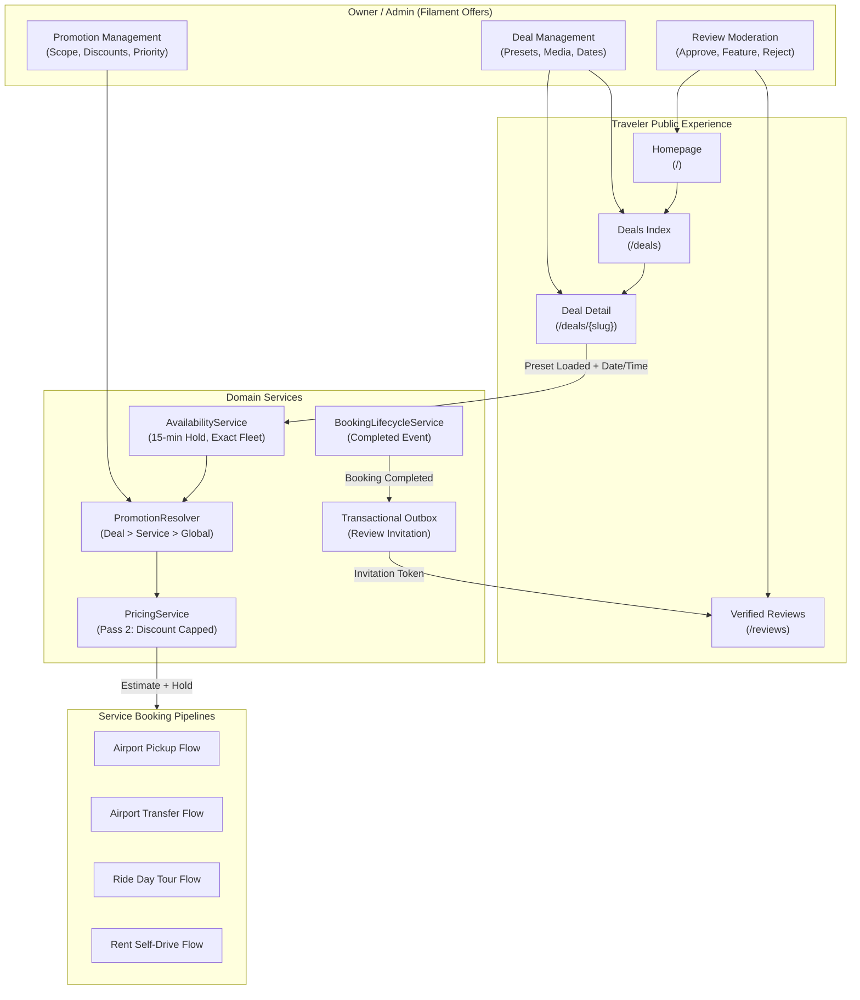

# Spinellanka Phase 10A Architecture Design: Public Experience, Deals, Promotions & Post-Trip Reviews

**Branch:** `phase/10a-public-deals-promotions`  
**Status:** Approved by EGM Architecture Review  
**Date:** 2026-11-26  

---

## 1. Executive Summary & Purpose

Phase 10A bridges the gap between raw service landing pages and customer travel intent. By introducing preconfigured **Deals** across all four services (Airport Pickup, Airport Transfer, Ride, Rent), a deterministic **Promotion Engine**, and a verified **Post-Service Review System**, Spinellanka provides a seamless browse-to-book experience without adopting competitor dark patterns.

### Key Objectives
1. **Curated Deals:** Enable travelers to browse preconfigured popular routes, tour packages, and airport transfers on `/deals`, view rich details on `/deals/{slug}`, select travel dates and times, and continue into the exact service booking flow with verified vehicle suitability and pricing.
2. **Single Non-Stacking Promotions:** Provide a deterministic promotion resolution engine supporting Deal, Service, and Global discounts. Enforce single-discount caps, prevent stacking, shield security deposits from discounts, and handle ambiguity gracefully.
3. **Verified Post-Trip Reviews:** Trigger automated review invitations via the transactional outbox upon booking completion (`BookingStatus::Completed`), support direct verified reviews and Trustpilot/Google links, require staff moderation, and display authentic social proof on the homepage.
4. **Administrative Offers Governance:** Provide Owner and Admin roles with full control over Deals, Promotions, and Reviews via Filament resources under an **Offers** cluster gated by `offers.manage`.

---

## 2. Architecture & Data Flow



---

## 3. Relational Schema & Models

### 3.1 Migration: `create_deals_and_promotions_tables`
```sql
CREATE TABLE deals (
    id BIGINT UNSIGNED AUTO_INCREMENT PRIMARY KEY,
    slug VARCHAR(128) NOT NULL UNIQUE,
    service_type VARCHAR(32) NOT NULL, -- airport_pickup, airport_transfer, ride, rent
    title VARCHAR(255) NOT NULL,
    summary VARCHAR(500) NOT NULL,
    description_markdown TEXT NOT NULL,
    preset_payload JSON NOT NULL, -- Presets for service forms (pickup, dropoff, hours, stops)
    image_path VARCHAR(255) NULL,
    image_alt VARCHAR(255) NULL,
    image_source VARCHAR(255) NULL,
    image_approver VARCHAR(255) NULL,
    image_approved_at TIMESTAMP NULL,
    status VARCHAR(32) NOT NULL DEFAULT 'draft', -- draft, published, archived
    is_featured BOOLEAN NOT NULL DEFAULT FALSE,
    priority INT NOT NULL DEFAULT 0,
    published_at TIMESTAMP NULL,
    expires_at TIMESTAMP NULL,
    promotion_id BIGINT UNSIGNED NULL,
    created_by_user_id BIGINT UNSIGNED NULL,
    updated_by_user_id BIGINT UNSIGNED NULL,
    created_at TIMESTAMP NULL,
    updated_at TIMESTAMP NULL,
    FOREIGN KEY (created_by_user_id) REFERENCES users(id) ON DELETE SET NULL,
    FOREIGN KEY (updated_by_user_id) REFERENCES users(id) ON DELETE SET NULL,
    INDEX idx_deals_status_window (status, published_at, expires_at),
    INDEX idx_deals_service (service_type),
    INDEX idx_deals_featured (is_featured, priority)
) ENGINE=InnoDB DEFAULT CHARSET=utf8mb4 COLLATE=utf8mb4_unicode_ci;

CREATE TABLE promotions (
    id BIGINT UNSIGNED AUTO_INCREMENT PRIMARY KEY,
    name VARCHAR(255) NOT NULL,
    code VARCHAR(64) NULL UNIQUE,
    explanation VARCHAR(500) NOT NULL,
    scope VARCHAR(32) NOT NULL DEFAULT 'global', -- global, service, deal
    service_type VARCHAR(32) NULL,
    deal_id BIGINT UNSIGNED NULL,
    discount_type VARCHAR(32) NOT NULL, -- fixed_amount, percentage_basis_points
    discount_value INT UNSIGNED NOT NULL, -- Minor units or basis points
    currency VARCHAR(3) NULL DEFAULT 'USD',
    status VARCHAR(32) NOT NULL DEFAULT 'draft', -- draft, active, archived
    priority INT NOT NULL DEFAULT 0,
    starts_at TIMESTAMP NULL,
    ends_at TIMESTAMP NULL,
    created_by_user_id BIGINT UNSIGNED NULL,
    updated_by_user_id BIGINT UNSIGNED NULL,
    created_at TIMESTAMP NULL,
    updated_at TIMESTAMP NULL,
    FOREIGN KEY (deal_id) REFERENCES deals(id) ON DELETE CASCADE,
    FOREIGN KEY (created_by_user_id) REFERENCES users(id) ON DELETE SET NULL,
    FOREIGN KEY (updated_by_user_id) REFERENCES users(id) ON DELETE SET NULL,
    INDEX idx_promotions_scope (scope, service_type, deal_id),
    INDEX idx_promotions_status_window (status, starts_at, ends_at),
    INDEX idx_promotions_priority (priority)
) ENGINE=InnoDB DEFAULT CHARSET=utf8mb4 COLLATE=utf8mb4_unicode_ci;

ALTER TABLE deals ADD CONSTRAINT fk_deals_promotion_id FOREIGN KEY (promotion_id) REFERENCES promotions(id) ON DELETE SET NULL;
```

### 3.2 Migration: `create_reviews_table`
```sql
CREATE TABLE reviews (
    id BIGINT UNSIGNED AUTO_INCREMENT PRIMARY KEY,
    booking_id BIGINT UNSIGNED NOT NULL UNIQUE,
    traveler_name VARCHAR(255) NOT NULL,
    traveler_country VARCHAR(2) NULL,
    service_type VARCHAR(32) NOT NULL,
    rating INT UNSIGNED NOT NULL, -- 1 to 5
    title VARCHAR(255) NULL,
    review_text TEXT NOT NULL,
    source VARCHAR(32) NOT NULL DEFAULT 'direct', -- direct, trustpilot, google
    external_url VARCHAR(500) NULL,
    status VARCHAR(32) NOT NULL DEFAULT 'pending_moderation', -- pending_moderation, published, rejected
    is_featured BOOLEAN NOT NULL DEFAULT FALSE,
    verified_trip BOOLEAN NOT NULL DEFAULT TRUE,
    invitation_token VARCHAR(64) NULL UNIQUE,
    invited_at TIMESTAMP NULL,
    submitted_at TIMESTAMP NULL,
    moderated_by_user_id BIGINT UNSIGNED NULL,
    moderated_at TIMESTAMP NULL,
    moderation_notes TEXT NULL,
    created_at TIMESTAMP NULL,
    updated_at TIMESTAMP NULL,
    FOREIGN KEY (booking_id) REFERENCES bookings(id) ON DELETE CASCADE,
    FOREIGN KEY (moderated_by_user_id) REFERENCES users(id) ON DELETE SET NULL,
    INDEX idx_reviews_status_featured (status, is_featured),
    INDEX idx_reviews_service (service_type)
) ENGINE=InnoDB DEFAULT CHARSET=utf8mb4 COLLATE=utf8mb4_unicode_ci;
```

### 3.3 Estimate & Proposal Delta Migration
- `estimates.applied_deal_id` (nullable bigint unsigned)
- `estimates.applied_promotion_id` (nullable bigint unsigned)
- `estimates.promotion_snapshot` (nullable json)
- `proposals.applied_deal_id` (nullable bigint unsigned)
- `proposals.applied_promotion_id` (nullable bigint unsigned)

---

## 4. Promotion Engine Rules & Calculation Invariants

1. **Resolution Hierarchy:**
   - Deal-specific promotion $\rightarrow$ Service-specific promotion $\rightarrow$ Global promotion.
   - Within the winning scope, the record with highest `priority` is selected.
   - Ambiguity (two active promotions sharing identical scope and identical priority) resolves to `null` with an audit warning; no promotion is applied.
2. **Pricing Pipeline Integration:**
   - Evaluated in `PricingService` Pass 2 (Discounts).
   - If the pricing rule already contains an intrinsic discount component, the promotion is skipped (non-stacking guarantee).
   - Maximum discount is capped at the service subtotal: `min(discountAmount, subtotal)`.
   - Taxable base is reduced by the discount amount.
   - Security deposits (Pass 4) are calculated on base rates and are **never** discounted.

---

## 5. Review System Lifecycle

1. **Service Completion Trigger:**
   When staff completes a booking via `BookingLifecycleService::complete($booking, $staff)`:
   - System generates high-entropy `invitation_token`.
   - Inserts `Review` record with `status: PendingModeration`.
   - Dispatches transactional outbox event: `booking.review_invited`.
2. **Customer Submission:**
   - Traveler visits `/reviews/submit/{token}`.
   - Form accepts star rating (1–5), optional review title, and detailed feedback.
   - Traveler is also presented with links to post directly to Spinellanka's verified Trustpilot profile.
3. **Moderation & Display:**
   - Appears in Filament `ReviewResource`.
   - Admin approves and optionally toggles `is_featured`.
   - Approved featured reviews render on the homepage carousel with customer name, verified trip badge, star rating, service type, and Trustpilot attribution.

---

## 6. Permissions & Security

- **Permission:** `Permission::OffersManage = 'offers.manage'`. Assigned to Owner and Admin roles.
- **Media Gate:** Public views verify `deal->isMediaApproved()`. If unapproved or missing, the view gracefully renders an approved text-only hero layout.
- **CSRF & Rate Limiting:** Public review submissions are throttled (`throttle:10,1`) and validate CSRF tokens.

