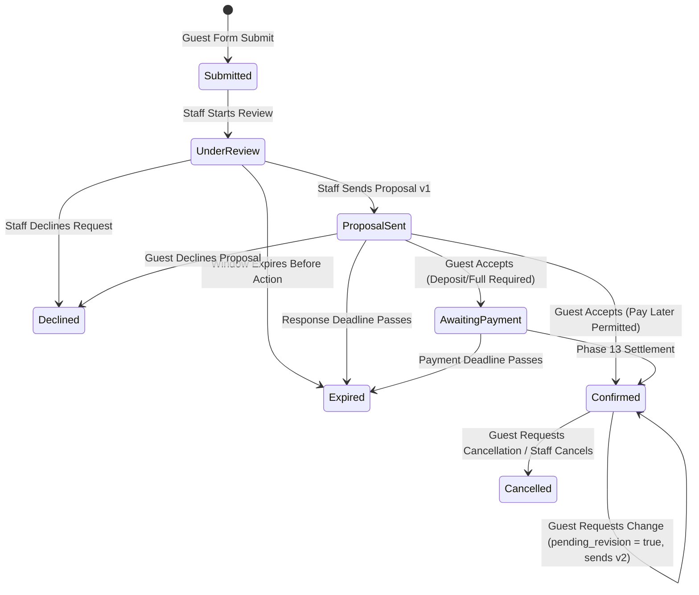

# Spinellanka Phase 12 Architecture Design: Versioned Proposals & Private Guest Control

**Branch:** `phase/12-proposals-guest-control`  
**Status:** Approved by EGM Architecture Review  
**Date:** 2026-11-25  

---

## 1. Core Architectural Principles

1. **Dual-Track Revision Preservation (Pillar B)**:
   - When a booking is already `Confirmed`, requesting changes or drafting a revision MUST NOT cancel or roll back the booking.
   - The original confirmed booking and its active schedule block remain authoritative and enforceable.
   - The booking receives `pending_revision = true`, and a new `Proposal` (version N+1) is dispatched with a `ProposalHold` schedule block.
   - If the new proposal is accepted, the booking transitions to the new parameters, retiring the old schedule block and adopting the new one.
   - If the new proposal is declined or expires, the booking remains `Confirmed`, releasing only the proposal hold and setting `pending_revision = false`.
2. **Proposal Immutability (Pillar A)**:
   - Once a proposal reaches status `sent`, it is strictly immutable.
   - Any price change, itinerary change, or vehicle reassignment creates a new proposal version (`version = N+1`) and marks the previous one `superseded`.
   - Complete operational parameters are snapshotted in `snapshot_data`, and itemized pricing components are stored in `proposal_items`.
3. **Availability Engine Integrity**:
   - Proposal holds use `ScheduleBlockKind::ProposalHold` (`expires_at = proposal->expires_at`).
   - Revision proposal holds pass `ignoreBlockId = booking->schedule_block_id` to prevent self-conflict deadlocks on the same vehicle.
   - Proposal expiry or cancellation releases strictly `ProposalHold` blocks, never touching `ConfirmedBooking` blocks.
4. **Zero-Leakage Guest Control**:
   - High-entropy tokens (`bin2hex(random_bytes(32))`), stored strictly as SHA-256 hashes (`token_hash`).
   - Guest routes maintain `/booking/{reference}/{token}` and enforce privacy headers (`noindex, nofollow`, `Referrer-Policy: no-referrer`, `Cache-Control: no-store, private`).
   - Constant-time verification with neutral 404 responses for invalid, expired, or revoked tokens.
   - Internal staff notes (`internal_notes`) are hidden from guest payloads and mapped through `GuestProposalViewDTO`.
5. **Phase 13 Online Payment Boundary**:
   - Proposals specify permitted payment choices: `full_only`, `deposit_only`, `full_or_deposit`, `pay_later_only`, `full_or_pay_later`.
   - If the traveler accepts with `pay_later` (when permitted), the booking confirms immediately with `ConfirmationChannel::GuestPrivateLink`.
   - If the traveler accepts with online payment (`full` or `deposit`), the booking transitions to `AwaitingPayment`. Actual payment processing occurs in Phase 13.

---

## 2. Domain Lifecycle & State Machine



### Revision State Lifecycle on Confirmed Bookings:
- Booking status remains `BookingStatus::Confirmed`.
- Flag: `pending_revision = true`.
- Relationship: `current_proposal_id` points to the new Proposal (version 2).
- Proposal status: `ProposalStatus::Sent`.
- On Guest Accept (Pay Later): `pending_revision = false`, snapshot updates booking attributes, old schedule block is released, proposal hold is converted to `ConfirmedBooking`.
- On Guest Accept (Online Payment): `pending_revision = false`, booking transitions to `AwaitingPayment` for the price difference/deposit.
- On Guest Decline or Expiry: `pending_revision = false`, proposal hold is released, existing confirmed booking and schedule block remain untouched!

---

## 3. Database Schema

### Migration 1: `create_proposals_and_items_tables`
```sql
CREATE TABLE proposals (
    id BIGINT UNSIGNED AUTO_INCREMENT PRIMARY KEY,
    booking_id BIGINT UNSIGNED NOT NULL,
    version INT UNSIGNED NOT NULL DEFAULT 1,
    reference VARCHAR(32) NOT NULL, -- e.g. PROP-SP-2026-0001-V1
    status VARCHAR(32) NOT NULL, -- draft, sent, accepted, declined, superseded, expired
    vehicle_id BIGINT UNSIGNED NOT NULL,
    service_type VARCHAR(32) NOT NULL,
    schedule_block_id BIGINT UNSIGNED NULL,
    starts_at DATETIME NOT NULL,
    ends_at DATETIME NOT NULL,
    currency VARCHAR(3) NOT NULL DEFAULT 'EUR',
    total_amount_minor_units INT UNSIGNED NOT NULL,
    approximate_lkr_amount_minor_units BIGINT UNSIGNED NOT NULL,
    deposit_required BOOLEAN NOT NULL DEFAULT FALSE,
    deposit_amount_minor_units INT UNSIGNED NOT NULL DEFAULT 0,
    payment_choice VARCHAR(32) NOT NULL, -- full_only, deposit_only, full_or_deposit, pay_later_only, full_or_pay_later
    selected_payment_choice VARCHAR(32) NULL, -- full, deposit, pay_later
    expires_at DATETIME NOT NULL,
    staff_notes TEXT NULL, -- Guest visible
    internal_notes TEXT NULL, -- Staff only, hidden from API/Blade
    sent_by_user_id BIGINT UNSIGNED NULL,
    sent_at DATETIME NULL,
    responded_at DATETIME NULL,
    response_action VARCHAR(32) NULL, -- accepted, declined, change_requested
    response_notes TEXT NULL,
    snapshot_data JSON NOT NULL,
    created_at TIMESTAMP NULL,
    updated_at TIMESTAMP NULL,
    CONSTRAINT fk_proposals_booking FOREIGN KEY (booking_id) REFERENCES bookings(id) ON DELETE CASCADE,
    CONSTRAINT fk_proposals_vehicle FOREIGN KEY (vehicle_id) REFERENCES vehicles(id),
    CONSTRAINT fk_proposals_staff FOREIGN KEY (sent_by_user_id) REFERENCES users(id) ON DELETE SET NULL,
    UNIQUE KEY uq_booking_version (booking_id, version),
    INDEX idx_proposal_reference (reference),
    INDEX idx_proposal_status_expiry (status, expires_at)
);

CREATE TABLE proposal_items (
    id BIGINT UNSIGNED AUTO_INCREMENT PRIMARY KEY,
    proposal_id BIGINT UNSIGNED NOT NULL,
    component_type VARCHAR(32) NOT NULL, -- PricingComponentType enum value
    description VARCHAR(255) NOT NULL,
    quantity DECIMAL(10,2) NOT NULL DEFAULT 1.00,
    unit VARCHAR(32) NOT NULL, -- PricingUnit enum value
    unit_price_minor_units INT UNSIGNED NOT NULL,
    total_amount_minor_units INT UNSIGNED NOT NULL,
    is_deposit BOOLEAN NOT NULL DEFAULT FALSE,
    is_tax BOOLEAN NOT NULL DEFAULT FALSE,
    is_discount BOOLEAN NOT NULL DEFAULT FALSE,
    sort_order INT UNSIGNED NOT NULL DEFAULT 0,
    created_at TIMESTAMP NULL,
    updated_at TIMESTAMP NULL,
    CONSTRAINT fk_proposal_items_proposal FOREIGN KEY (proposal_id) REFERENCES proposals(id) ON DELETE CASCADE,
    INDEX idx_proposal_items_sort (proposal_id, sort_order)
);
```

### Migration 2: `add_proposal_fields_to_bookings_table`
```sql
ALTER TABLE bookings 
    ADD COLUMN current_proposal_id BIGINT UNSIGNED NULL AFTER customer_id,
    ADD COLUMN pending_revision BOOLEAN NOT NULL DEFAULT FALSE AFTER status,
    ADD CONSTRAINT fk_bookings_current_proposal FOREIGN KEY (current_proposal_id) REFERENCES proposals(id) ON DELETE SET NULL;
```

---

## 4. Enums & DTOs

### 4.1 Enums
1. **`BookingStatus`**:
   - `Submitted = 'submitted'`
   - `UnderReview = 'under_review'`
   - `ProposalSent = 'proposal_sent'`
   - `AwaitingPayment = 'awaiting_payment'`
   - `Confirmed = 'confirmed'`
   - `Declined = 'declined'`
   - `Cancelled = 'cancelled'`
   - `Expired = 'expired'`
2. **`ProposalStatus`**:
   - `Draft = 'draft'`
   - `Sent = 'sent'`
   - `Accepted = 'accepted'`
   - `Declined = 'declined'`
   - `Superseded = 'superseded'`
   - `Expired = 'expired'`
3. **`ProposalPaymentChoice`**:
   - `FullOnly = 'full_only'`
   - `DepositOnly = 'deposit_only'`
   - `FullOrDeposit = 'full_or_deposit'`
   - `PayLaterOnly = 'pay_later_only'`
   - `FullOrPayLater = 'full_or_pay_later'`
4. **`PaymentOption`**:
   - `Full = 'full'`
   - `Deposit = 'deposit'`
   - `PayLater = 'pay_later'`
5. **`ConfirmationChannel`**:
   - Add `GuestPrivateLink = 'guest_private_link'`

### 4.2 Data Transfer Objects (DTOs)
- **`CreateProposalData`**:
  `vehicleId`, `startsAt`, `endsAt`, `currency`, `items` (array of `EstimateItemData`), `paymentChoice`, `depositRequired`, `depositAmountMinorUnits`, `expiresAt`, `staffNotes`, `internalNotes`, `snapshotData`.
- **`ProposalSnapshotData`**:
  Typed operational snapshot containing journey details, vehicle specs, flight number, pickup/dropoff locations, cancellation terms version, and line item summaries.
- **`BookingTransitionResult`**:
  `booking`, `proposal`, `requiresPayment` (bool), `paymentMode` (string), `amountDueMinorUnits` (int), `nextAction` (string).
- **`GuestProposalViewDTO`**:
  Strict guest-facing representation stripping `internal_notes` and internal margins.

---

## 5. Domain Services Architecture

### 5.1 `ProposalService`
- `createDraft(Booking $booking, CreateProposalData $data, ?User $staff): Proposal`
- `sendProposal(Proposal $proposal, ?User $staff): Proposal`:
  - Validates booking is `UnderReview` or `Confirmed`.
  - Creates `ScheduleBlockKind::ProposalHold` via `AvailabilityService::createProposalHold`.
  - Sets `proposal->status = ProposalStatus::Sent`, `sent_at = now()`.
  - Sets `booking->current_proposal_id = $proposal->id`.
  - If booking was `UnderReview`, sets `booking->status = BookingStatus::ProposalSent`. If `Confirmed`, sets `booking->pending_revision = true`.
  - Dispatches outbox event `booking.proposal_sent`.
  - Audit log action: `proposal.sent`.
- `reviseProposal(Booking $booking, CreateProposalData $data, ?User $staff): Proposal`:
  - Increments version number (`$booking->proposals()->max('version') + 1`).
  - Marks previous sent proposal as `Superseded` and releases its temporary `ProposalHold` block (never touching confirmed blocks).
  - Creates and dispatches the new proposal.
- `expireProposal(Proposal $proposal): void`:
  - Releases `ProposalHold` block.
  - Updates `proposal->status = ProposalStatus::Expired`.
  - If booking was `ProposalSent`, sets `booking->status = BookingStatus::Expired`. If `Confirmed`, sets `pending_revision = false`.
  - Dispatches outbox event `booking.proposal_expired`.

### 5.2 `GuestControlService`
- `acceptProposal(Booking $booking, Proposal $proposal, PaymentOption $choice, ?string $notes = null): BookingTransitionResult`:
  - Acquires deterministic pessimistic locks (`lockForUpdate()`) on `Vehicle`, `Booking`, and `Proposal`.
  - Idempotency guard: If already accepted, return existing transition result.
  - Validates proposal is active (`status === 'sent'` and `!isExpired()`).
  - Validates `$choice` against proposal's allowed choices.
  - If `$choice === PaymentOption::PayLater`:
    - Converts `ProposalHold` to `ConfirmedBooking` (releasing old confirmed block if this is a revision).
    - Hydrates booking details from proposal snapshot.
    - Confirms booking with `ConfirmationChannel::GuestPrivateLink`.
    - Updates proposal to `Accepted`.
    - Dispatches outbox event `booking.confirmed`.
  - If `$choice !== PaymentOption::PayLater`:
    - Transitions booking to `AwaitingPayment`.
    - Marks proposal `Accepted`.
    - Dispatches outbox event `booking.awaiting_payment`.
- `declineProposal(Booking $booking, Proposal $proposal, ?string $reason = null): void`:
  - Locks rows.
  - Releases `ProposalHold`.
  - Updates proposal to `Declined`.
  - If `booking->status === Confirmed`: sets `pending_revision = false` (booking remains confirmed).
  - If `booking->status === ProposalSent`: sets `booking->status = BookingStatus::Declined`.
  - Dispatches outbox event `booking.proposal_declined`.
- `requestChange(Booking $booking, string $changeNotes): void`:
  - Marks `pending_revision = true`.
  - Dispatches outbox event `booking.change_requested`.
- `cancelBooking(Booking $booking, ?string $reason = null): void`:
  - Validates cancellation policy cutoffs.
  - Cancels booking and releases all schedule blocks.
  - Dispatches outbox event `booking.cancelled`.

### 5.3 `AvailabilityService` Extensions
- `createProposalHold(Vehicle $vehicle, Carbon $start, Carbon $end, ServiceType $service, Carbon $expiresAt, ?int $ignoreBlockId = null): VehicleScheduleBlock`
- `confirmProposalBlock(VehicleScheduleBlock $proposalBlock, ?VehicleScheduleBlock $priorConfirmedBlock = null): VehicleScheduleBlock`
- `expireStaleProposalHolds(): int`

---

## 6. Private Guest Control UI & Security

1. **Route**: `/booking/{reference}/{token}`
2. **Components**:
   - Real-time Status Banner (Submitted, Under Review, Proposal Ready, Awaiting Payment, Confirmed, etc.).
   - Interactive Proposal Summary & Comparison: Side-by-side comparison between original request and proposed changes.
   - Payment Choice Selectors: Accessible radio cards for permitted options (`Pay in Full`, `Pay Deposit`, `Pay Later`).
   - Accessible Native Dialog Modals (`<dialog>`):
     - Accept Proposal Modal.
     - Decline Proposal Modal.
     - Request Changes Modal.
     - Cancel Booking Modal.
     - Rent Extension Request Modal.
3. **Security Headers**:
   - `X-Robots-Tag: noindex, nofollow`
   - `Referrer-Policy: no-referrer`
   - `Cache-Control: no-store, private`

---

## 7. Filament Staff UI

1. **Seam**: `App\Filament\Resources\BookingResource\Pages\ViewBooking`
2. **Actions**:
   - `CreateProposalAction`: Available when booking is `UnderReview`.
   - `ReviseProposalAction`: Available when booking has a sent proposal or is `Confirmed`. Requires password re-authentication when revising a `Confirmed` booking.
   - `RotateGuestLinkAction`: Revokes existing token and generates a new secure guest access token.
3. **Relation Manager**:
   - `ProposalsRelationManager`: Tabular view of all proposal versions (v1, v2, ...), timestamps, statuses, line items, and audit diffs.

