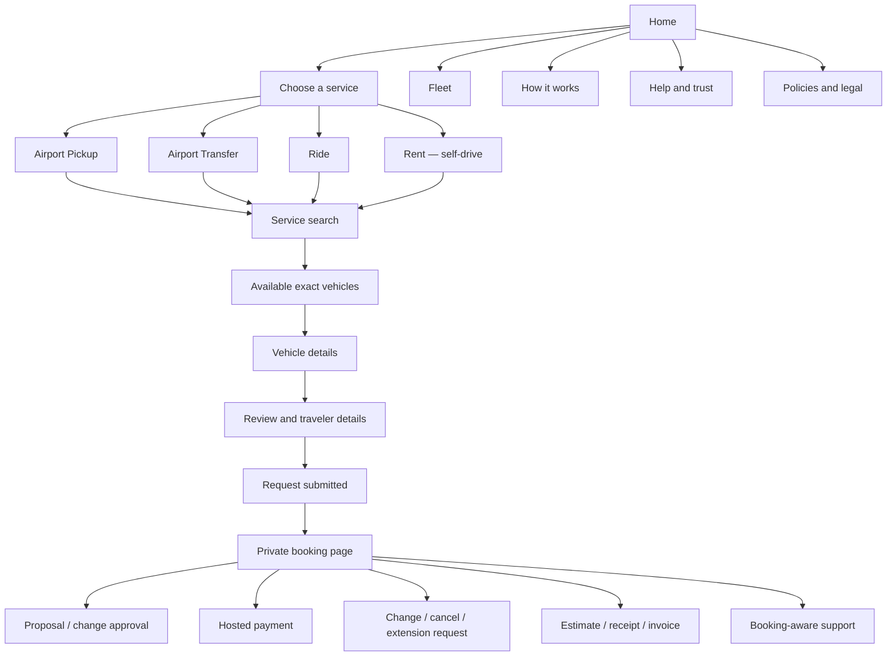
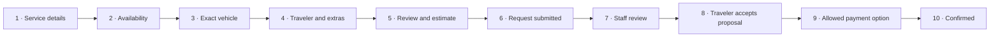
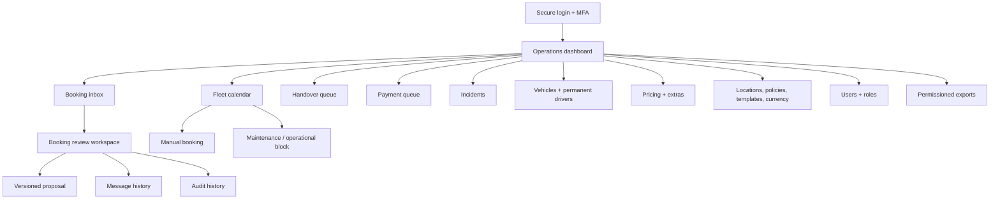

# 02 — Information Architecture

**Purpose:** define page hierarchy, navigation, boundaries, and content priority before visual design.

## 1. Architecture principles

1. **Choose the service first.** The four services require different inputs and policy explanations; one universal form would create ambiguity.
2. **Separate public explanation from private action.** Marketing/help pages may be indexed; booking, driver, admin, payment, and handover pages must not be indexed.
3. **One shared booking spine, four tailored starts.** Service forms converge at availability, exact vehicle selection, review, and submission.
4. **Private link replaces an account.** Status, proposals, payments, changes, documents, and support live in one secure guest space.
5. **Operations organize around attention and time.** Admin home prioritizes work queues; the calendar is the authority for fleet availability.
6. **Content must state what is provisional.** Estimate, availability result, staff proposal, payment, and confirmation are distinct states.

## 2. Top-level map

## 3. Public sitemap

### 3.1 Primary navigation

- **Book**
  - Airport Pickup
  - Airport Transfer
  - Ride
  - Rent
- **Fleet**
- **How it works**
- **Help**
- **Contact / WhatsApp**

On narrow screens, “Book” expands to the four services. Support remains easy to reach but does not compete with the primary “Choose a service” action.

### 3.2 Home

**Job:** orient a first-time international visitor and start the correct service flow.

Content order:

1. Advance-booking statement and current scope marker.
2. Four service choices with concise inclusions.
3. Shared process: enter details → choose exact vehicle → staff confirms → pay as offered → travel.
4. Exact-fleet explanation and verified proof placeholders.
5. International traveler guidance: Sri Lanka time, USD/LKR, WhatsApp, staff confirmation.
6. Support and policy links.

Home must not imply instant dispatch, guaranteed availability before confirmation, or self-drive service with a driver.

### 3.3 Service pages

Each page uses the same content skeleton:

1. Plain-language definition.
2. Included/not included.
3. Required details.
4. How availability and estimate work.
5. Relevant policy summary.
6. Tailored service form.
7. FAQ and support.

Service-specific emphasis:

| Page | Emphasize |
|---|---|
| Airport Pickup | Supported arrival airports, flight details, meet-and-greet, waiting/delay/no-show behavior |
| Airport Transfer | Flight departure, recommended pickup time, airport-arrival buffer, timing warning |
| Ride | Ordered stops, waiting per stop, separate return leg, route-change rules |
| Rent | Self-drive/no driver, 24-hour duration, handover, eligibility, original-document check, deposit/insurance/mileage/fuel |

### 3.4 Fleet

- Fleet overview and “exact vehicle” explanation
- One profile per supplied vehicle
- Seats and luggage
- Transmission and A/C
- Service eligibility
- Amenities/features
- Rental-specific terms where relevant
- Real photos and verified permanent-driver information for chauffeured service
- Starting/pricing-context copy only when approved
- “Check availability” action opens a service-first flow; a vehicle alone is insufficient to calculate availability

### 3.5 How it works

Separate tabs/sections for:

- Chauffeured booking process
- Self-drive Rent process
- Estimate versus final proposal
- Staff confirmation and private link
- Payments and deadlines
- Changes and cancellation
- Service-day support

### 3.6 Help and trust

- About the business
- International traveler guide
- FAQ
- Contact/support
- Verified reviews/testimonials when available and consented
- Verified licensing/insurance/safety information when supplied
- Accessibility and assistance information

### 3.7 Policies and legal

- Terms of service
- Privacy notice
- Cookie notice/settings
- Cancellation/refund policy
- Chauffeured waiting/no-show policy
- Rent eligibility and terms
- Rent insurance/excess and security deposit
- Payment and currency policy
- Data request/contact route

Policy summaries appear in context; full pages remain the legal source once approved.

## 4. Booking architecture

### 4.1 Booking step behavior

- Show service name and Sri Lanka time context throughout.
- Use a progress indicator with text, not step numbers alone.
- Let travelers go back without losing safe data.
- Recalculate availability/price when a material field changes.
- Explain a stale result before requiring recheck.
- Show the 15-minute vehicle hold only after exact vehicle selection.
- Never label submission as “Booking confirmed.”

### 4.2 Shared search-to-checkout pages

Conceptual page set:

- Service form
- Searching/loading
- Results and filter summary
- No availability / alternatives
- Custom quote fallback
- Vehicle detail/compare
- Traveler and booker details
- Extras and special needs
- Review, estimate, and terms
- Submission success

These may be designed as pages, drawers, or a guided step flow in high-fidelity design, but each screen/state in the inventory must remain represented.

## 5. Private guest area

### 5.1 Private booking page

One secure page with anchored sections/tabs:

- Overview and status
- Next action and deadline
- Service itinerary/rental period
- Exact vehicle
- Driver/meeting details when assigned and relevant
- Proposal versions
- Price, payments, balance, and refund
- Estimates, receipts, and invoice
- Messages/notification status
- Change, cancellation, or Rent-extension request
- Contextual support
- Feedback after completion

### 5.2 Link entry and recovery

- Primary access: unguessable link from success screen, WhatsApp, and optional email.
- Every access page clearly shows the booking reference.
- Expired/revoked link state provides a safe recovery route without revealing booking data.
- No public booking-reference lookup is part of current scope.

### 5.3 Hosted payment boundary

The private page explains amount, currency, purpose, deadline, and chosen payment option, then opens provider-hosted checkout. Return states:

- Payment succeeded
- Payment pending
- Payment failed/cancelled
- Status unknown/recheck
- Duplicate attempt prevented

## 6. Internal admin architecture

### 6.1 Admin primary navigation

- Dashboard
- Bookings
- Calendar
- Fleet
- Drivers
- Rent handovers
- Payments
- Incidents
- Feedback
- Configuration
  - Pricing and extras
  - Locations and airports
  - Booking windows and buffers
  - Policies and terms
  - Currency/exchange rate
  - Message templates
  - Business/support details
- Users and roles (Owner/Admin only)
- Exports (permission-controlled)
- Audit

### 6.2 Booking review workspace hierarchy

1. Status, urgency, service, reference, and next action.
2. Conflict/eligibility/payment/message alerts.
3. Requested itinerary/rental details.
4. Availability and exact vehicle timeline.
5. Booker and lead traveler details.
6. Itemized estimate and editable final proposal.
7. Policy/eligibility checks.
8. Messages and actions.
9. Proposal versions, payment history, incident links, and audit.

The primary actions change with status. The interface must not show every possible action at once.

### 6.3 Fleet calendar hierarchy

- Date controls and day/week/month view
- Filters by vehicle, service, and status
- Five exact vehicle rows, each with tied driver identity
- Time-scale schedule
- Temporary holds
- Pending requests
- Confirmed/in-progress bookings
- Rent handover/return markers
- Maintenance/operational blocks
- Preparation buffers
- Conflict indicators
- Create manual booking/block action

## 7. Driver-link architecture

The secure driver link contains only:

1. Assignment status and acknowledge action.
2. Date/time in Sri Lanka time.
3. Exact vehicle and check reminder.
4. Pickup/meeting details.
5. Ordered route and stop waiting.
6. Necessary lead-traveler contact and assistance needs.
7. Support/emergency contact.
8. Status actions: En route → Arrived → Started → Completed.

It excludes pricing, payment, internal notes, other bookings, and customer history.

## 8. Rent handover architecture

### Collection

- Booking and renter identity
- Original passport/licence/permit inspection
- Eligibility confirmation
- Contract acceptance
- Payment/deposit status
- Odometer and fuel
- Existing damage diagram/photos
- Accessories/equipment
- Vehicle release checklist
- Staff/renter signatures

### Return

- Timing and extension status
- Odometer/mileage
- Fuel
- New damage comparison/photos
- Accessories
- Additional charges
- Security-deposit/refund decision
- Staff/renter signatures
- Close booking or open incident

## 9. Search and indexing boundaries

| Area | Publicly indexable | Authentication / token |
|---|---:|---|
| Home, service, fleet, help, policy pages | Yes, subject to SEO rules | None |
| Booking form/results/checkout | No | Anonymous session + temporary hold |
| Submission success | No | Anonymous session/private context |
| Private booking page | No | Expiring private token |
| Hosted payment | No | Provider-secured session |
| Driver trip link | No | Expiring/revocable driver token |
| Admin | No | Individual account + MFA + role permission |
| Handover/incident | No | Staff account + permission |

## 10. Responsive navigation model

### Customer mobile

- Compact header with working product identity, menu, and support.
- Service context remains visible during booking.
- One primary action per viewport.
- Sticky bottom action may be used for “Check availability,” “Continue,” or “Submit request,” never for secondary support.

### Customer desktop

- Full navigation and support action.
- Forms may use a primary content column plus a sticky summary column.
- Results use a readable list/grid without hiding essential terms behind hover.

### Admin desktop

- Persistent navigation rail.
- Dense but legible work queues and calendar.
- Booking review may use request/operations/proposal columns where width permits.

### Admin/staff mobile

- Prioritize today’s tasks, booking decision, contact, handover checklist, incident, and status update.
- Large calendar becomes agenda/list by default; detailed timeline may scroll within a labeled region.

### Driver mobile

- No global product navigation.
- Assignment, route, support, and one current status action dominate.

## 11. Content ownership

| Content | Owner | Approval needed |
|---|---|---|
| Service definitions and workflow copy | Product + client operations | Client |
| Vehicle/driver facts and images | Client | Client verifies accuracy/consent |
| Rates, deposits, tax, currency policy | Client finance/owner | Client |
| Waiting, cancellation, refund, no-show | Client operations/legal | Client/legal |
| Rent eligibility, insurance, damage terms | Client/legal/insurer | Client/legal |
| Privacy, cookie, retention, terms | Client/legal | Client/legal |
| Help/FAQ and travel guidance | Content + client operations | Client |
| Reviews/testimonials | Customer consent + client moderation | Client |
| UI labels/errors/status copy | UX/content | Product/client |

## 12. IA acceptance questions

The client should be able to answer “yes” to all:

- Can a visitor identify the correct service before entering details?
- Is self-drive Rent unmistakable?
- Is staff confirmation distinguished from website availability?
- Is the no-account private booking page sufficient for post-submission control?
- Can staff reach every operational task from an attention-based dashboard or calendar?
- Are public, private guest, driver, and authenticated staff areas clearly separated?
- Are legal/policy pages available both globally and in the relevant booking context?
