# 03 — User Flows

**Purpose:** show end-to-end behavior and handoffs between guest, staff, payment provider, permanent driver, and fleet schedule.

## 1. Shared booking flow

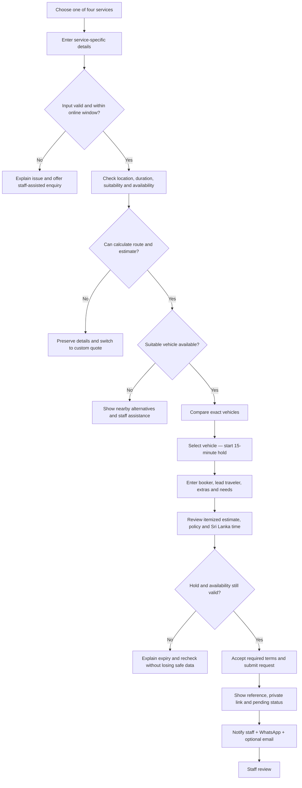

### Required distinctions

- Vehicle availability is not confirmation.
- Estimate is not final proposal.
- Request submitted is not confirmed.
- Customer action may be required before payment.
- Payment may be full, deposit, or deferred according to the final proposal.

## 2. Staff review and confirmation

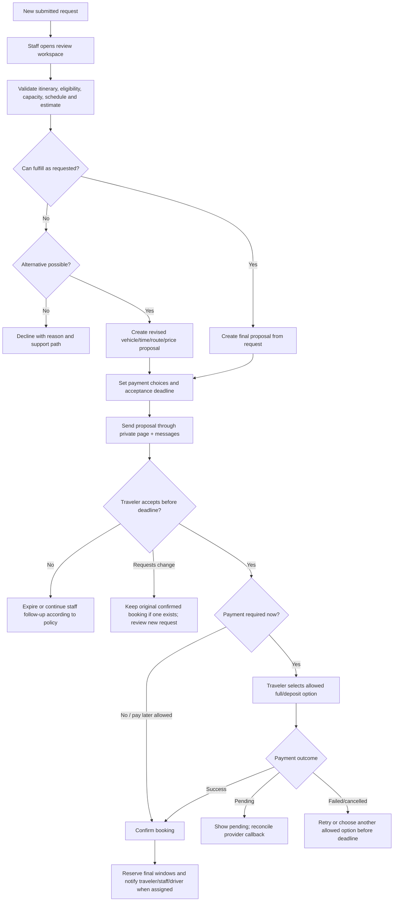

## 3. Airport Pickup flow

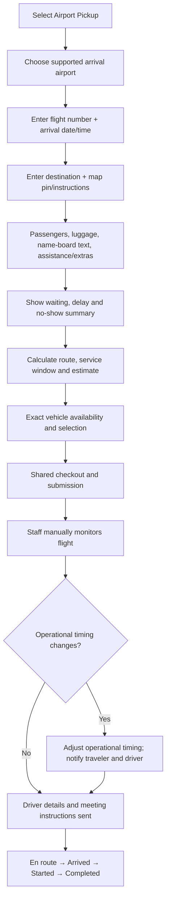

### Airport Pickup exceptions

- Unknown/unlisted airport → custom quote or unsupported-location guidance.
- Missing/invalid flight number → allow correction; staff-assisted fallback if policy permits.
- Flight delay → manual monitoring and policy-based timing adjustment.
- Traveler cannot find driver → urgent support with booking context.
- Waiting limit reached/no-show → staff records contact attempts, incident, and policy outcome.

## 4. Airport Transfer flow

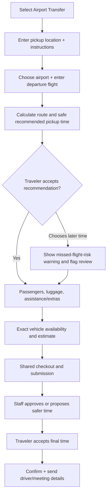

### Airport Transfer exceptions

- Route timing service unavailable → show staff-calculated-time custom review.
- Pickup is remote/uncertain → require map pin/instructions and custom quote if needed.
- Traveler insists on unsafe time → staff may decline or request explicit policy acknowledgment; final business rule is client input.

## 5. Ride flow

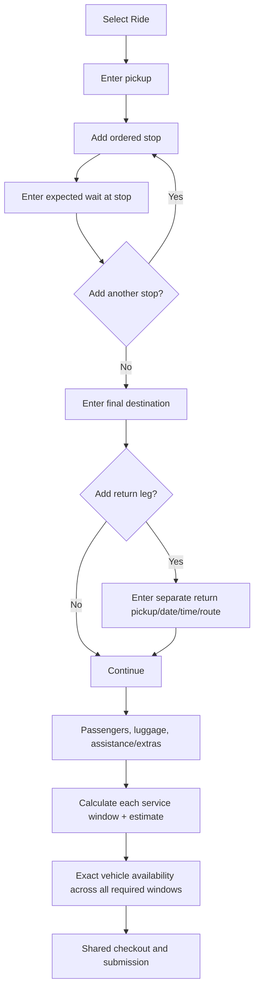

### Ride schedule rule

An outbound and return leg share one booking but do not automatically hold the vehicle between legs. Planned waiting holds and prices that time explicitly. If the exact vehicle is unavailable for one leg, the result must explain the conflict and offer supported alternatives rather than silently split vehicles.

### Confirmed Ride change

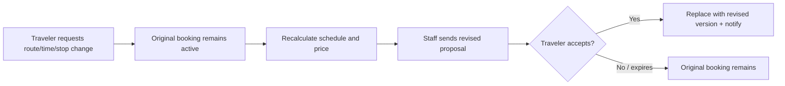

## 6. Rent flow

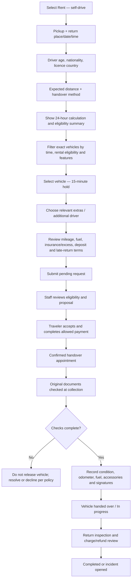

### Rent extension

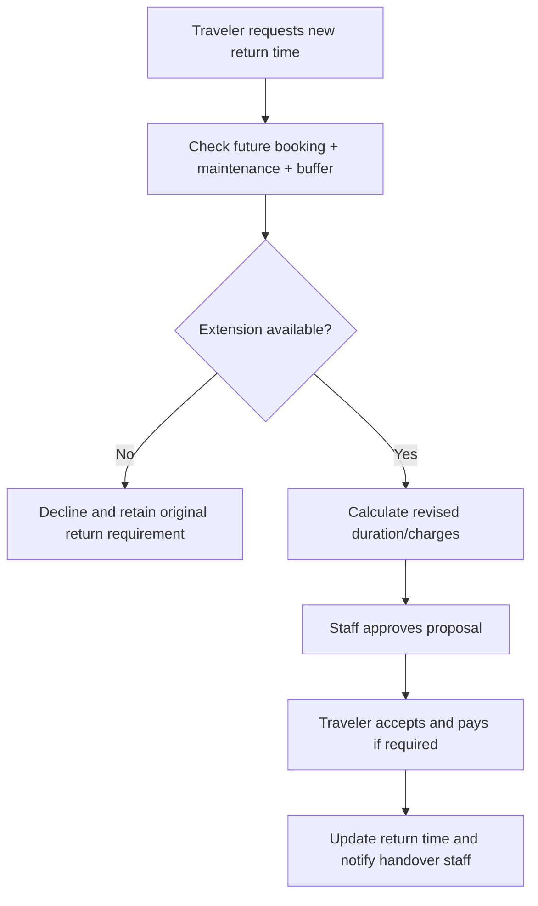

### Rent incident

- Urgent contact opens a booking-aware support path.
- Staff logs breakdown, accident, damage, safety issue, or dispute.
- Record facts, attachments, actions, charges, insurer/police references when applicable, and resolution.
- The UX does not replace emergency, legal, insurer, or roadside procedures supplied by the client.

## 7. No-availability flow

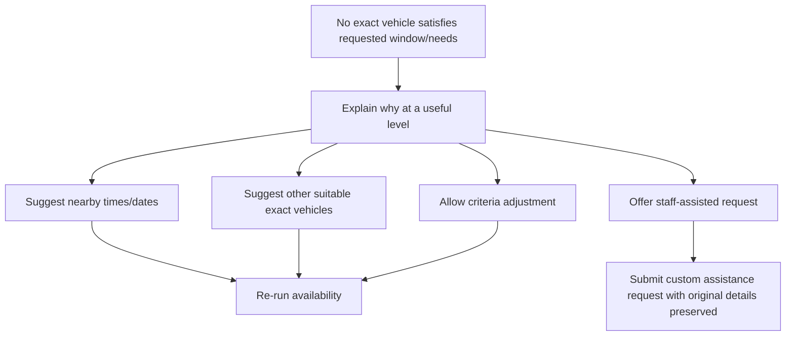

Do not expose another customer’s booking details when explaining unavailability.

## 8. Checkout-hold expiry flow

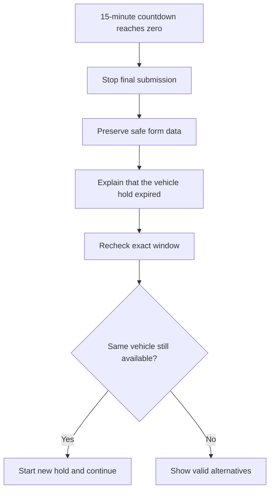

The timer must not be the only warning. Announce approaching expiry accessibly and avoid trapping a user who needs more time for accessibility reasons; final behavior may include a policy-controlled extension.

## 9. Proposal and payment flow

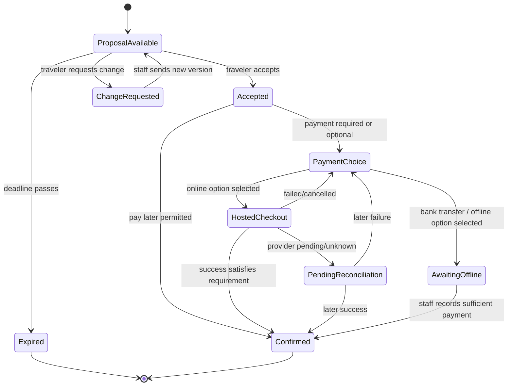

## 10. Change and cancellation flow

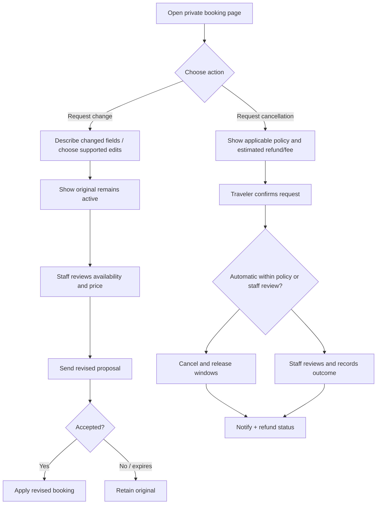

Exact auto/manual cancellation behavior depends on client-approved policy values.

## 11. Vehicle disruption after confirmation

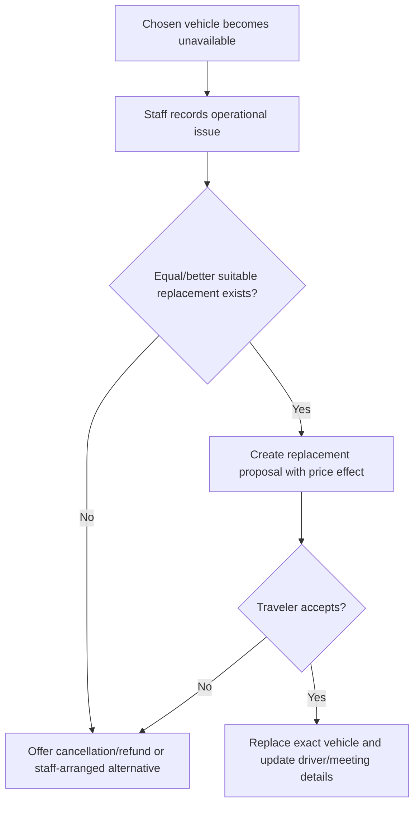

Never silently substitute the exact confirmed vehicle.

## 12. Driver flow

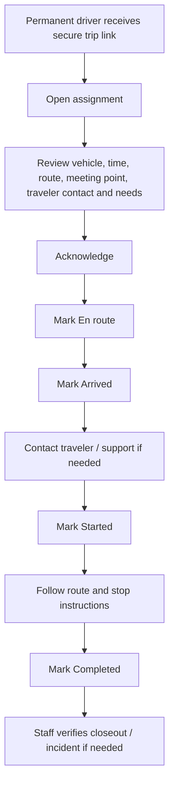

## 13. Rent handover flow

### Collection

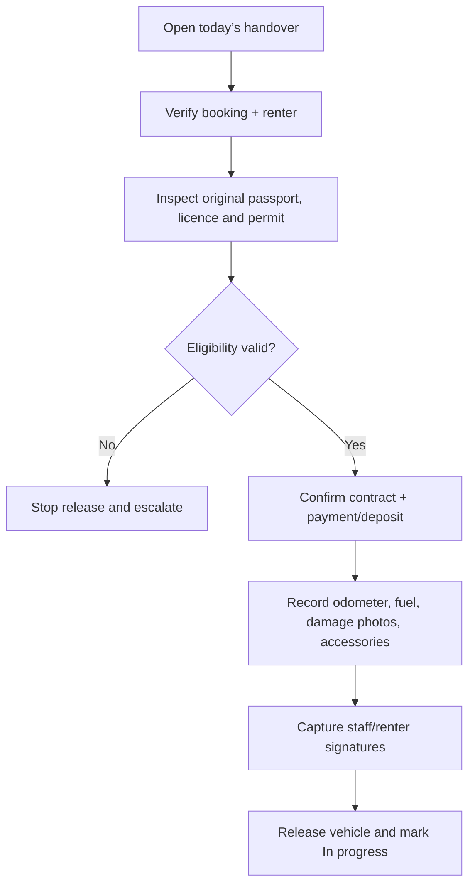

### Return

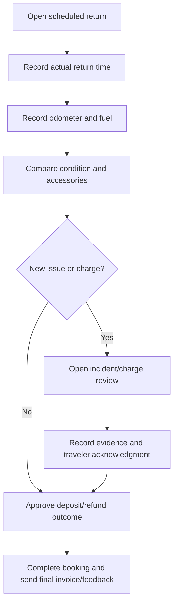

## 14. Notification-failure flow

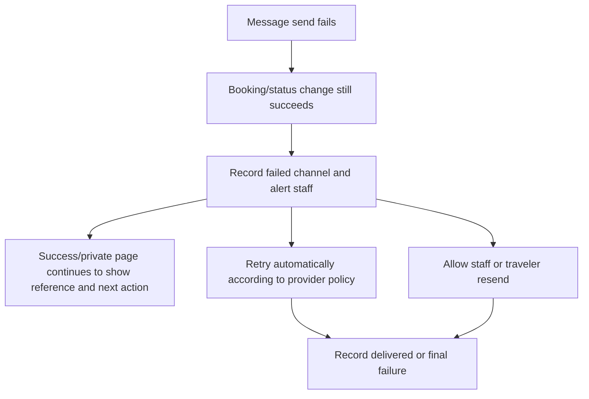

## 15. Feedback flow

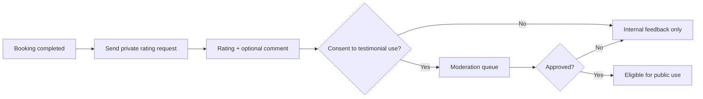

## 16. Status ownership

| Transition | Primary actor | Required evidence/action |
|---|---|---|
| Hold → Submitted | Guest/system | Terms accepted, authoritative availability recheck, reference created |
| Submitted → Under review | Staff/system | Staff opens/claims request or queue rule applies |
| Under review → Proposal sent | Staff | Versioned details, price, payment choices, deadline, message |
| Proposal → Accepted | Guest | Explicit acceptance with timestamp/version |
| Accepted → Awaiting payment | System/staff | Payment requirement exists |
| Accepted/Awaiting payment → Confirmed | System/staff | Required acceptance/payment satisfied |
| Confirmed → In progress | Driver/staff | Service started or Rent handed over |
| In progress → Completed | Driver/staff | Service closeout or Rent return completed |
| Any eligible state → Cancelled | Guest/staff | Policy outcome, reason, release, refund status |
| Review → Declined | Staff | Reason, alternative/support path, release |
| Hold/proposal/payment → Expired | System/staff | Deadline elapsed, notification, release |

## 17. Flow acceptance checks

- No flow silently skips staff confirmation.
- No flow loses a traveler’s valid original confirmed booking while a change is being considered.
- No flow exposes a selectable incompatible/overlapping vehicle.
- No flow requires an account.
- No payment flow collects raw card details in the product.
- Every dead end offers a safe explanation and next action.
- Every material action has an owner, state change, notification effect, and audit event.
